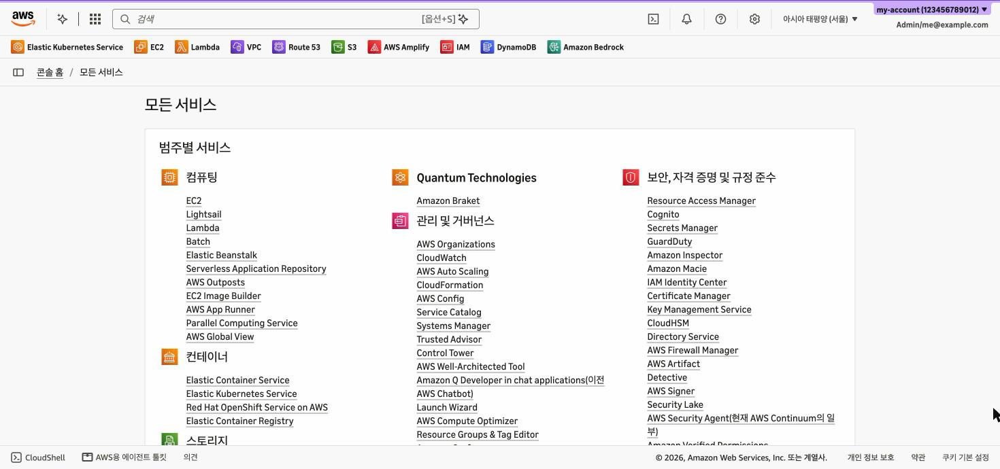
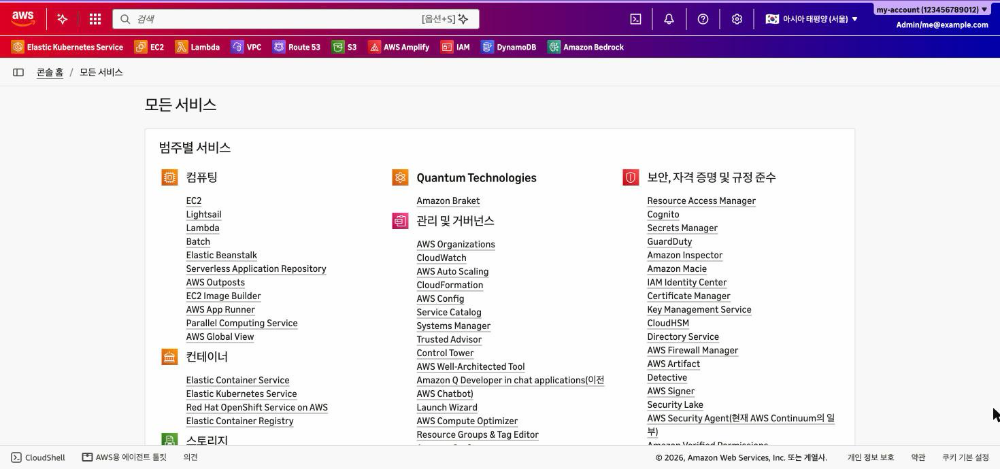
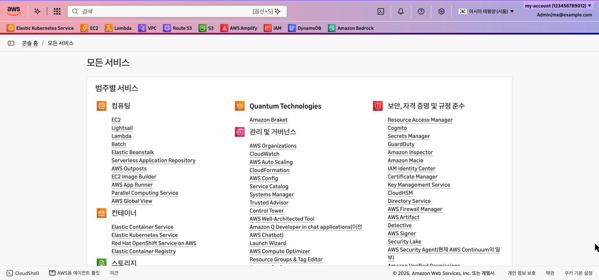

# AWS Colorful Navbar

> Identify AWS regions instantly with colorful navbar gradients and country flags.

## Features

* Region-based navigation bar gradients inspired by country flags (globe colors for global services)
* Two navbar styles: **Vivid** (flag colors, white text) and **Subtle** (pastel flag colors, dark text)
* Readable navbar text: at least 4.5:1 contrast (WCAG AA) for every region and custom color
* Custom color themes per region (2-4 colors)
* Region flags next to the region selector and in the region menu
* Works with the new AWS Console design and with the AWS account color
* Detects global services from the page title, independent of the console language text (checked in the Korean console)
* Dark/Light popup theme, auto-save settings

## Installation

* [Chrome Web Store](https://chrome.google.com/webstore/detail/aws-colorful-navbar/kgifmgnlchjjippdpkblbdlfidcpceme)
* [Microsoft Edge](https://chrome.google.com/webstore/detail/aws-colorful-navbar/kgifmgnlchjjippdpkblbdlfidcpceme)
* [Mozilla Firefox](https://addons.mozilla.org/firefox/addon/aws-colorful-navbar/)

## Configuration

The extension supports the following configuration options:

* `background`: Enable/disable navbar color customization
* `flag`: Enable/disable region flag display
* `style`: Navbar style, `vivid` (default) or `subtle`
* `customColors`: Custom gradient colors per region (2-4 colors)
* `theme`: Dark/Light mode of the popup

Colors that would make the navbar text hard to read are adjusted: Vivid darkens light colors, Subtle uses lighter tints. The popup preview shows the adjusted colors.

### AWS account color

The AWS Console can show an account color (a thin stripe above the navbar and a colored account name). The extension keeps it. Use the account color to identify the account and the extension to identify the region.

## Supported Regions

See [flags/README.md](flags/README.md) for a complete list of supported regions and their corresponding flags.

## Screenshots

Before (AWS Console default):

Vivid style (Seoul):

Subtle style (Seoul):

## Documentation

* [Architecture](specs/ARCHITECTURE.md) - Technical architecture and component details
* [Changelog](specs/CHANGELOG.md) - Version history and release notes

## For Developers

### Installation

* Open the Extension Management page by navigating to `chrome://extensions`
* Enable `Developer Mode` by clicking the toggle switch
* Click the `LOAD UNPACKED` button and select the extension directory

### Development

* Clone the repository
* Make changes to the source code
* Test locally using the unpacked extension
* Run the unit tests: `node --test 'tests/*.test.js'` (Node.js 22+, no dependencies)
* After a change in `colors.js`, copy it to `docs/colors.js` (CI checks that they are equal)
* Run `./package.sh` to create release packages (requires `jq`)
* Submit pull requests for improvements

## Contributing

Contributions are welcome! Please feel free to submit a Pull Request.

## License

This project is licensed under the MIT License - see the LICENSE file for details.
